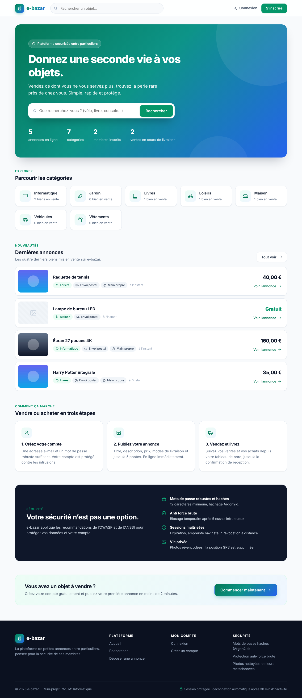
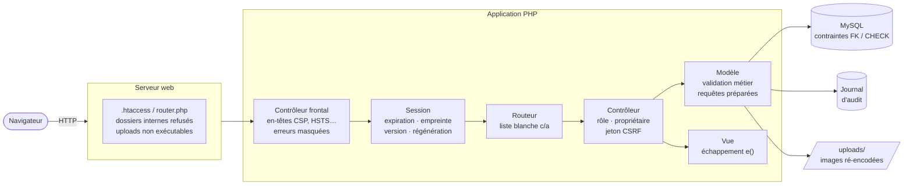
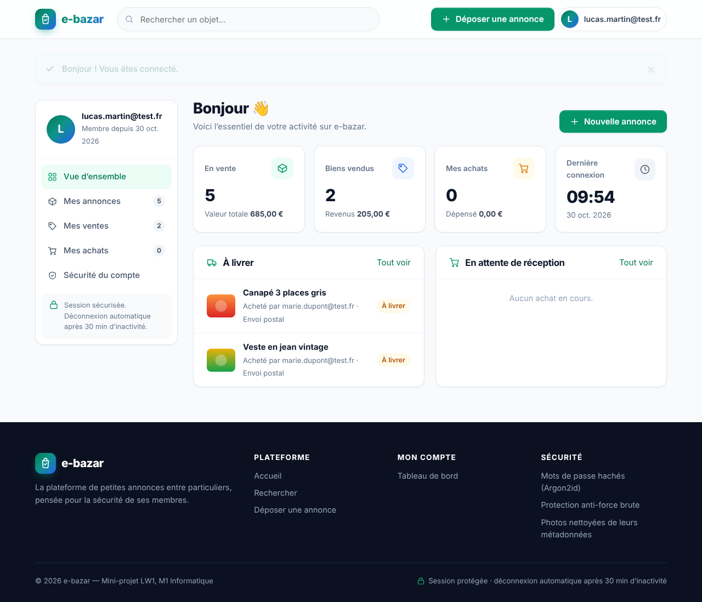
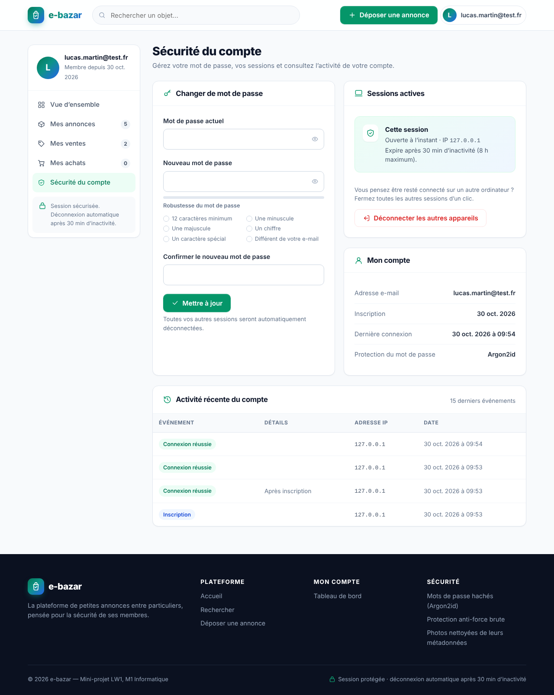
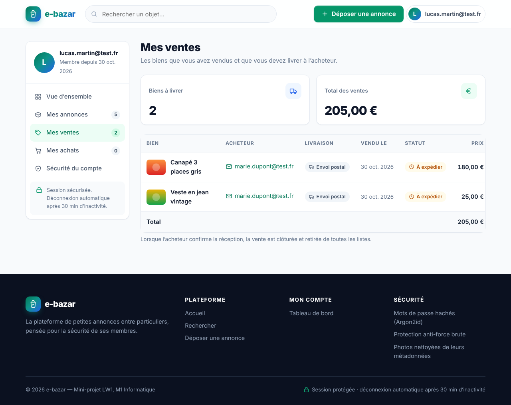
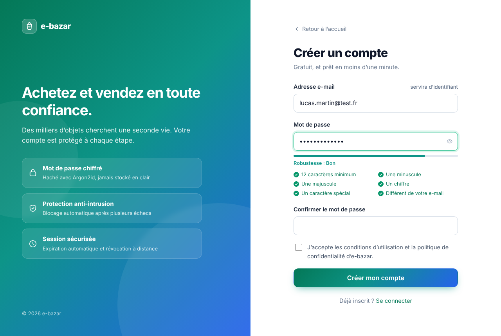

<div align="center">

# 🛡️ e-bazar — Secure-by-Design Marketplace

**Plateforme de petites annonces développée selon une approche _security by design_ :
modélisation des menaces, défense en profondeur et tests d'intrusion automatisés.**


[Modèle de menaces](docs/THREAT_MODEL.md) ·
[Contrôles de sécurité](docs/SECURITY_CONTROLS.md) ·
[Tests d'intrusion](docs/SECURITY_TESTS.md) ·
[Architecture](docs/ARCHITECTURE.md) ·
[Déploiement durci](docs/DEPLOYMENT.md) ·
[Politique de sécurité](SECURITY.md)



</div>

---

## Sommaire

- [Contexte](#contexte)
- [Posture de sécurité en un coup d'œil](#posture-de-sécurité-en-un-coup-dœil)
- [Architecture de défense en profondeur](#architecture-de-défense-en-profondeur)
- [Couverture OWASP Top 10 (2021)](#couverture-owasp-top-10-2021)
- [Tests d'intrusion automatisés](#tests-dintrusion-automatisés)
- [Démarrage rapide](#démarrage-rapide)
- [Fonctionnalités](#fonctionnalités)
- [Structure du dépôt](#structure-du-dépôt)
- [Limites connues et pistes d'amélioration](#limites-connues-et-pistes-damélioration)

## Contexte

Projet réalisé dans le cadre du module **LW1 — Master 1 Informatique**. Le cahier des charges demandait une
plateforme de vente entre particuliers (inscription, dépôt d'annonces avec photos, achat, suivi de livraison,
administration) en architecture **MVC**.

Le parti pris de ce dépôt : traiter l'application **comme une cible**. Chaque fonctionnalité a été
conçue à partir d'un [modèle de menaces STRIDE](docs/THREAT_MODEL.md), puis vérifiée par une
[suite de 63 tests d'attaque](tests/security/run.sh) exécutée en intégration continue.

Choix volontaire : **aucune dépendance tierce** (ni framework ni bibliothèque). Toute la sécurité est
implémentée et expliquée explicitement, sans surface d'attaque liée à la chaîne d'approvisionnement.

## Posture de sécurité en un coup d'œil

| Domaine | Mesures mises en œuvre |
|---|---|
| 🔑 **Authentification** | Argon2id (repli bcrypt) · politique ANSSI (12+ caractères, 4 classes, pas l'identifiant, pas de mot courant) · messages et temps de réponse uniformes (anti-énumération) |
| 🚫 **Anti force brute** | Verrouillage 15 min après 5 échecs par couple (e-mail, IP) · 20 échecs par IP tous comptes confondus · alerte au propriétaire du compte à la connexion suivante |
| 🍪 **Sessions** | `HttpOnly`, `SameSite`, `Secure` en HTTPS · mode strict (anti-fixation) · régénération périodique · empreinte navigateur (anti-rejeu) · expiration (30 min d'inactivité / 8 h) · **révocation à distance** par version de session |
| 🧱 **Injections** | Requêtes préparées natives (émulation PDO désactivée) · échappement contextuel des sorties · jokers `LIKE` neutralisés · routeur à liste blanche |
| 🛂 **Contrôle d'accès** | Vérification serveur du rôle **et** du propriétaire sur chaque action (anti-IDOR) · moindre privilège : l'administrateur ne peut pas produire de contenu |
| 🔁 **CSRF** | Jeton 256 bits par session, comparaison à temps constant, renouvelé à la connexion · actions d'état uniquement en POST · redirection 303 (PRG) |
| 🖼️ **Téléversements** | Type vérifié sur le contenu (magic bytes) · taille et dimensions bornées · **ré-encodage GD** : neutralise les JPEG polyglottes et supprime l'EXIF (GPS) · nom aléatoire 128 bits · exécution interdite |
| 🧾 **En-têtes** | CSP stricte sans `unsafe-inline` · `frame-ancestors 'none'` · `nosniff` · `Referrer-Policy` · `Permissions-Policy` · HSTS en HTTPS · `no-store` sur les pages privées |
| 📜 **Journalisation** | Journal d'audit : connexions, échecs, blocages, sessions suspectes, changements de mot de passe, actions d'administration — consultable par l'admin et, pour son compte, par chaque membre |
| 🏎️ **Logique métier** | Achat atomique (`UPDATE … WHERE statut = 'en_vente'`) : immunisé contre les situations de compétition |

## Architecture de défense en profondeur

Chaque requête traverse plusieurs couches indépendantes : la compromission de l'une ne suffit pas.



## Couverture OWASP Top 10 (2021)

| Risque | Statut | Principaux contrôles | Tests |
|---|:---:|---|:---:|
| **A01** Broken Access Control | ✅ | Contrôle du rôle et du propriétaire côté serveur, routeur à liste blanche, CSRF, dossiers internes refusés | 15 |
| **A02** Cryptographic Failures | ✅ | Argon2id, jetons `random_bytes`, cookie `Secure` + HSTS en HTTPS | (via A07) |
| **A03** Injection | ✅ | Requêtes préparées, échappement des sorties, CSP stricte | 6 |
| **A04** Insecure Design | ✅ | Modèle de menaces STRIDE, achat atomique, limitation de débit, contrôle des téléversements | 5 |
| **A05** Security Misconfiguration | ✅ | En-têtes de sécurité, erreurs masquées, installateur verrouillé, fichiers internes inaccessibles | 13 |
| **A06** Vulnerable Components | ✅ | Aucune dépendance tierce | — |
| **A07** Identification & Auth. Failures | ✅ | Politique de mot de passe, anti force brute, anti-énumération, sessions durcies, révocation | 18 |
| **A08** Software & Data Integrity | ✅ | Ré-encodage des fichiers téléversés, contenu vérifié et non pas l'extension | 2 |
| **A09** Logging & Monitoring Failures | ✅ | Journal d'audit, tableau de bord sécurité de l'admin, alerte au membre | 4 |
| **A10** SSRF | ➖ | Non applicable : l'application n'émet aucune requête sortante | — |

➡️ Détail, justifications et emplacement exact dans le code : [docs/SECURITY_CONTROLS.md](docs/SECURITY_CONTROLS.md)

## Tests d'intrusion automatisés

[`tests/security/run.sh`](tests/security/run.sh) attaque l'application **en boîte noire, via HTTP**, comme le
ferait un attaquant : 63 scénarios en 10 familles, exécutés à chaque `push` par
[GitHub Actions](.github/workflows/security.yml).

```text
4. Gestion des sessions (A07)
  ✔ PASS  Fixation de session : un identifiant imposé est rejeté (strict mode)
  ✔ PASS  Détournement : cookie volé rejoué depuis un autre navigateur → session détruite
  ✔ PASS  Révocation : « déconnecter les autres appareils » ferme l'autre session
6. Injections (A03 — Injection)
  ✔ PASS  Injection SQL UNION dans la recherche : aucune donnée exfiltrée, pas d'erreur
  ✔ PASS  XSS stockée : le script injecté est échappé à l'affichage
8. Logique métier : situation de compétition (achat simultané)
  ✔ PASS  10 achats simultanés du même bien → exactement 1 réussite
9. Téléversement de fichiers malveillants (A04 / A08)
  ✔ PASS  JPEG polyglotte : le code PHP caché est éliminé par le ré-encodage
  ✔ PASS  Vie privée : les métadonnées EXIF (position GPS) sont supprimées

Résultat : 63 réussi(s), 0 échec(s)
```

La fiabilité de la suite a été vérifiée par **test de mutation** : en réintroduisant volontairement une
faille (échappement désactivé, verrouillage désactivé), les tests correspondants échouent.
Voir [docs/SECURITY_TESTS.md](docs/SECURITY_TESTS.md).

## Démarrage rapide

**Prérequis :** PHP ≥ 8.1 (extensions `pdo_mysql`, `mbstring`, `gd`, `fileinfo`) et MySQL/MariaDB.

```bash
# 1. Base de données
sudo mysql -e "CREATE DATABASE ebazar CHARACTER SET utf8mb4;
CREATE USER 'ebazar'@'localhost' IDENTIFIED BY 'change-moi';
GRANT ALL ON ebazar.* TO 'ebazar'@'localhost';"

# 2. Serveur de développement (le routeur applique les mêmes protections qu'Apache)
cd src && php -S localhost:8000 router.php
```

Ouvrez <http://localhost:8000> : l'assistant d'installation crée les tables et le compte administrateur.

**Lancer les tests de sécurité** (sur une base **dédiée**, le script réinstalle l'application) :

```bash
sudo mysql -e "CREATE DATABASE ebazar_test; GRANT ALL ON ebazar_test.* TO 'ebazar'@'localhost';"
DB_NAME=ebazar_test DB_PASS=change-moi ./tests/security/run.sh
```

Déploiement sur Apache (production) et checklist de durcissement : [docs/DEPLOYMENT.md](docs/DEPLOYMENT.md).

## Fonctionnalités

| | |
|:---:|:---:|
|  |  |
| **Tableau de bord** : ventes, revenus, achats, actions en attente | **Sécurité du compte** : mot de passe, sessions, historique |
|  |  |
| **Mes ventes** : acheteur, mode de livraison, statut | **Inscription** : jauge de robustesse alignée sur la politique serveur |

- **Visiteur** : catégories, recherche, listes paginées, fiche détaillée avec galerie.
- **Membre** : dépôt d'annonces (5 photos JPEG max), achat, confirmation de réception, tableau de bord
  (en vente / ventes / achats), gestion de la sécurité de son compte.
- **Administrateur** (compte unique) : modération des annonces et des membres, catégories, journal de sécurité.

## Structure du dépôt

```
.
├── src/                         Application (racine web)
│   ├── index.php                Contrôleur frontal : point d'entrée unique
│   ├── router.php               Routeur sécurisé pour « php -S »
│   ├── app/core/                Noyau MVC : routeur, session, contrôleur, modèle, helpers
│   ├── app/models/              Modèles : Utilisateur, Annonce, Photo, Categorie, Journal
│   ├── app/controllers/         Contrôleurs : Auth, Annonce, Achat, Compte, Admin, Install…
│   ├── app/views/               Vues (aucun accès à la base de données)
│   ├── public/                  CSS / JS (aucun script en ligne → CSP stricte)
│   └── sql/                     Schéma (contraintes FK et CHECK)
├── tests/security/run.sh        Suite de tests d'intrusion (63 scénarios)
├── docs/                        Modèle de menaces, contrôles, tests, architecture, déploiement
├── .github/workflows/           Intégration continue : lint, tests de sécurité, recherche de secrets, SAST
└── SECURITY.md                  Politique de divulgation responsable
```

## Limites connues et pistes d'amélioration

La sécurité est un processus. Les limites assumées, et ce qui serait fait ensuite :

- **Pas de MFA** (TOTP / WebAuthn) : prochaine étape naturelle pour les comptes à privilèges.
- **Pas de vérification de l'adresse e-mail** ni de réinitialisation du mot de passe (hors périmètre du sujet).
- **Pas de vérification contre les fuites** (API *Have I Been Pwned* en k-anonymat) : la liste locale de
  mots courants n'en est qu'une approximation.
- **HTTPS** non configuré sur la VM de test : `Secure` et HSTS s'activent automatiquement sous TLS.
- **Limitation par `REMOTE_ADDR`** : derrière un reverse proxy, il faudrait configurer une liste de proxys de confiance.
- **Journal en base** : en production, il serait exporté vers un SIEM (syslog / JSON) avec une rétention définie.

---

<sub>Projet académique — Master 1 Informatique. Signalement de vulnérabilité : voir [SECURITY.md](SECURITY.md).</sub>
