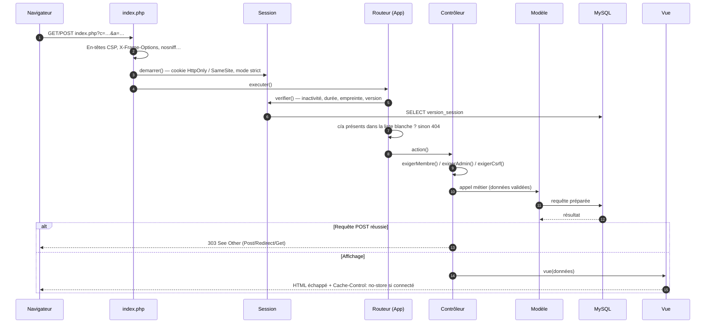
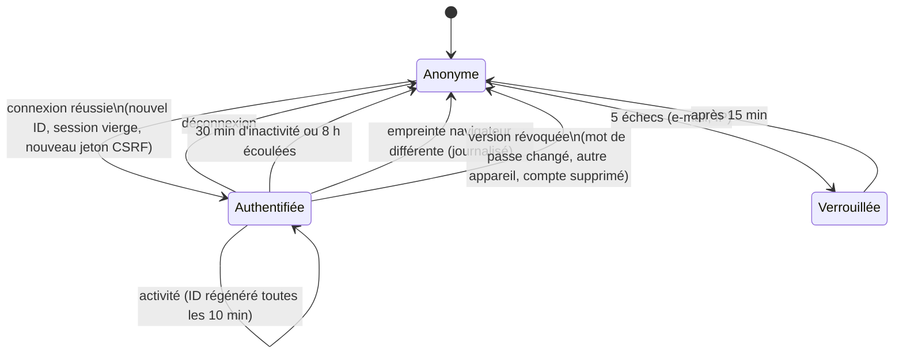
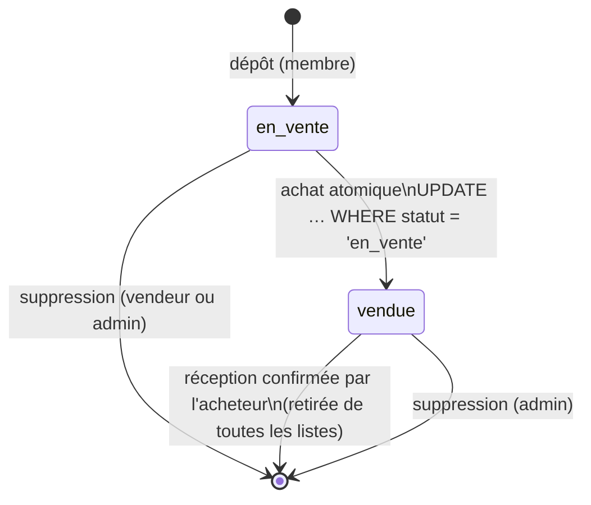
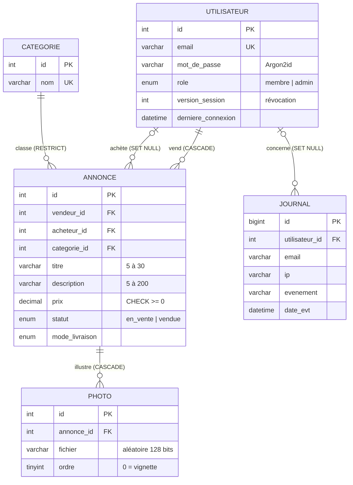

# Architecture

Application PHP 8 sans framework, organisée selon le patron **Modèle-Vue-Contrôleur** avec un
**contrôleur frontal** unique.

## Couches

| Couche | Dossier | Responsabilité | Ce qu'elle ne fait jamais |
|---|---|---|---|
| Contrôleur frontal | `src/index.php` | Point d'entrée unique, en-têtes de sécurité, chargement automatique | Logique métier |
| Noyau | `src/app/core/` | Routage, session, accès aux données, rendu | — |
| Contrôleurs | `src/app/controllers/` | Droits d'accès, CSRF, orchestration, redirections | Requêtes SQL, HTML |
| Modèles | `src/app/models/` | Règles métier, validation, requêtes préparées | Lire `$_GET` / `$_POST`, produire du HTML |
| Vues | `src/app/views/` | Affichage, échappement des données | Accès à la base |

## Cycle d'une requête

## Cycle de vie d'une session

## Cycle de vie d'une annonce

## Modèle de données

## API client ↔ serveur

URL : `index.php?c=<contrôleur>&a=<action>[&id=N]`. Toute action qui modifie l'état est en **POST**
et exige le champ `csrf`.

| Méthode | c / a | Paramètres | Accès | Effet |
|---|---|---|---|---|
| GET | `home/index` | — | tous | Catégories et compteurs, 4 dernières annonces |
| GET | `categorie/voir` | `id`, `page` | tous | Liste paginée (10 par page) |
| GET | `annonce/rechercher` | `q` (≤ 60), `page` | tous | Recherche dans le titre et la description |
| GET | `annonce/voir` | `id` | tous* | Fiche détaillée, galerie |
| GET/POST | `auth/inscription` | `email`, `mot_de_passe`, `confirmation`, `cgu` | anonyme | Création du compte |
| GET/POST | `auth/connexion` | `email`, `mot_de_passe` | anonyme | Connexion limitée, reprise de l'opération |
| POST | `auth/deconnexion` | — | connecté | Fin de session |
| GET/POST | `annonce/deposer` | `categorie_id`, `titre`, `description`, `prix`, `livraison_postale`, `livraison_main_propre`, `photos[]` | membre | Dépôt |
| POST | `annonce/supprimer` | `id` | vendeur, bien non vendu | Suppression |
| GET/POST | `achat/acheter` | `id`, `mode_livraison` | membre ≠ vendeur | Achat atomique |
| POST | `achat/confirmerReception` | `id` | acheteur | Clôture de la vente |
| GET | `compte/index` | `onglet` | membre | Tableau de bord |
| POST | `compte/motDePasse` | `actuel`, `nouveau`, `confirmation` | membre | Changement + révocation des autres sessions |
| POST | `compte/revoquerSessions` | — | membre | Déconnexion des autres appareils |
| GET | `admin/index` | `onglet`, `filtre` | admin | Tableau de bord, journal de sécurité |
| POST | `admin/ajouterCategorie` · `admin/renommerCategorie` | `nom` (+ `id`) | admin | Catégories |
| POST | `admin/supprimerAnnonce` · `admin/supprimerUtilisateur` | `id` | admin | Modération |
| GET/POST | `install/index` | paramètres BD + compte admin | avant installation | Initialisation |

\* Un bien vendu n'est visible que par son vendeur, son acheteur et l'administrateur.

Codes de réponse : `303` après un POST réussi, `403` accès refusé, `404` introuvable,
`405` mauvaise méthode, `500` erreur interne (message générique).
