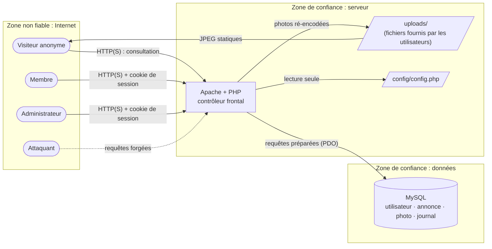

# Modèle de menaces — e-bazar

Méthode : **STRIDE** appliqué à un diagramme de flux de données (DFD), puis évaluation du risque
(probabilité × impact) avant et après contre-mesures. Ce document a guidé la conception ; chaque
contre-mesure est vérifiée par un test de [`tests/security/run.sh`](../tests/security/run.sh).

## 1. Périmètre et hypothèses

- Application web PHP / MySQL déployée sur un serveur Apache unique.
- L'attaquant est **externe et non authentifié**, ou **membre authentifié malveillant**.
- Hors périmètre : compromission du système d'exploitation, de MySQL ou d'Apache ; attaques physiques ;
  déni de service volumétrique (réseau) ; paiement et livraison (non gérés par la plateforme).
- Hypothèse : en production, le service est exposé en **HTTPS** (TLS terminé par Apache).

## 2. Actifs à protéger

| Actif | Sensibilité | Pourquoi |
|---|---|---|
| Identifiants des membres (e-mail, mot de passe) | **Critique** | Réutilisation fréquente des mots de passe sur d'autres services |
| Sessions authentifiées | **Critique** | Une session volée équivaut au compte |
| Compte administrateur | **Critique** | Suppression de membres et d'annonces |
| Données de transaction (acheteur ↔ vendeur, e-mails) | Élevée | Données personnelles (RGPD), risque d'arnaque |
| Photos déposées | Élevée | Peuvent contenir la position GPS du domicile (EXIF) |
| Intégrité des annonces et des achats | Moyenne | Fraude, double vente |
| Disponibilité du service | Moyenne | — |
| Identifiants de la base (`config/config.php`) | **Critique** | Accès direct à toutes les données |

## 3. Diagramme de flux de données et frontières de confiance

**Frontières franchies** (là où toute donnée est considérée comme hostile) :

1. **Internet → application** : paramètres GET/POST, cookies, en-têtes, fichiers téléversés.
2. **Application → système de fichiers** : écriture de fichiers dont le contenu vient de l'utilisateur.
3. **Application → base de données** : données utilisateur intégrées à des requêtes.
4. **Base de données → navigateur** : contenu écrit par un membre, affiché à d'autres (XSS stockée).

## 4. Analyse STRIDE

Échelle : P = probabilité, I = impact (1 faible à 3 élevé) ; risque = P × I.
« Résiduel » = après contre-mesures.

### S — Usurpation d'identité (Spoofing)

| # | Menace | P×I | Contre-mesures | Résiduel |
|---|---|:---:|---|:---:|
| S1 | Force brute / credential stuffing sur la connexion | 3×3 = **9** | Verrouillage 15 min après 5 échecs (e-mail, IP) et 20 échecs par IP ; mot de passe non testé pendant le blocage ; alerte au membre | 1×3 = 3 |
| S2 | Mots de passe faibles | 3×3 = **9** | Politique : 12+ caractères, 4 classes, pas l'identifiant, liste de mots courants | 1×3 = 3 |
| S3 | Vol de cookie de session (XSS, réseau) | 2×3 = **6** | `HttpOnly`, `Secure` + HSTS, CSP stricte, empreinte navigateur, expiration | 1×3 = 3 |
| S4 | Fixation de session | 2×3 = **6** | `use_strict_mode`, `session_regenerate_id` à la connexion, session vierge | 1×2 = 2 |
| S5 | Énumération des comptes existants | 3×1 = 3 | Message unique, hachage factice (temps constant), e-mail masqué en public | 2×1 = 2 |
| S6 | Création massive de comptes (robots) | 2×2 = 4 | Pot de miel, 5 inscriptions max par IP et par heure | 1×2 = 2 |

### T — Altération (Tampering)

| # | Menace | P×I | Contre-mesures | Résiduel |
|---|---|:---:|---|:---:|
| T1 | Injection SQL | 2×3 = **6** | Requêtes préparées natives (`ATTR_EMULATE_PREPARES = false`), identifiants validés en entiers | 1×3 = 3 |
| T2 | CSRF (suppression, achat, déconnexion forcés) | 3×2 = **6** | Jeton 256 bits vérifié par `hash_equals`, `SameSite=Lax`, POST obligatoire | 1×2 = 2 |
| T3 | Falsification de paramètres (mode de livraison, prix, `id`) | 3×2 = **6** | Toute règle revérifiée côté serveur ; prix jamais transmis par le client lors de l'achat | 1×2 = 2 |
| T4 | Téléversement de webshell / JPEG polyglotte | 2×3 = **6** | Contrôle des *magic bytes*, ré-encodage GD, nom aléatoire, extension forcée, exécution désactivée dans `uploads/` | 1×3 = 3 |
| T5 | Double achat concurrent (situation de compétition) | 2×2 = 4 | `UPDATE … WHERE statut = 'en_vente'` atomique, vérification `rowCount() === 1` | 1×1 = 1 |

### R — Répudiation

| # | Menace | P×I | Contre-mesures | Résiduel |
|---|---|:---:|---|:---:|
| R1 | Un administrateur nie avoir supprimé un membre | 1×2 = 2 | Journal d'audit (acteur, IP, date, détail) | 1×1 = 1 |
| R2 | Attaque non détectée | 2×2 = 4 | Journalisation des échecs, blocages et sessions suspectes ; tableau de bord de l'admin ; alerte au membre | 1×2 = 2 |

### I — Divulgation d'informations

| # | Menace | P×I | Contre-mesures | Résiduel |
|---|---|:---:|---|:---:|
| I1 | Lecture de `config/config.php`, du SQL ou du code | 2×3 = **6** | `.htaccess` / `router.php` (403), garde `defined('EBAZAR') or exit`, droits fichiers 640 | 1×3 = 3 |
| I2 | Messages d'erreur techniques (chemins, SQL) | 2×2 = 4 | `display_errors = 0`, gestionnaire global → page générique, détail en journal serveur | 1×1 = 1 |
| I3 | Position GPS dans l'EXIF des photos | 3×2 = **6** | Ré-encodage systématique : seules les données de pixels sont conservées | 1×1 = 1 |
| I4 | Accès aux données d'un autre membre (IDOR) | 3×2 = **6** | Propriétaire vérifié côté serveur ; un bien vendu n'est visible que par ses parties | 1×2 = 2 |
| I5 | Pages privées en cache après déconnexion | 2×1 = 2 | `Cache-Control: no-store` | 1×1 = 1 |
| I6 | Fuite de l'URL privée via le Referer | 1×1 = 1 | `Referrer-Policy: same-origin` | 1×1 = 1 |

### D — Déni de service

| # | Menace | P×I | Contre-mesures | Résiduel |
|---|---|:---:|---|:---:|
| D1 | Verrouillage malveillant du compte d'une victime | 2×2 = 4 | Verrouillage par couple (e-mail, **IP**) : l'attaquant ne bloque que lui-même | 1×1 = 1 |
| D2 | Bombe de décompression d'image | 1×2 = 2 | 200 Kio max, dimensions ≤ 6000 px vérifiées **avant** le décodage | 1×1 = 1 |
| D3 | Requêtes coûteuses (recherche) | 1×2 = 2 | Requête bornée (60 caractères), pagination imposée | 1×1 = 1 |

### E — Élévation de privilèges

| # | Menace | P×I | Contre-mesures | Résiduel |
|---|---|:---:|---|:---:|
| E1 | Un membre accède aux actions d'administration | 2×3 = **6** | `exigerAdmin()` dans le **constructeur** de `AdminController` : aucune action ne peut l'oublier | 1×3 = 3 |
| E2 | Appel d'une méthode interne via l'URL (`?a=__construct`) | 2×3 = **6** | Routeur à liste blanche explicite (contrôleur → actions) | 1×1 = 1 |
| E3 | Prise de contrôle via l'installateur | 2×3 = **6** | Installateur inaccessible (403) dès que `config.php` existe | 1×3 = 3 |
| E4 | Session conservée après changement de mot de passe | 2×3 = **6** | Version de session incrémentée → toutes les autres sessions invalidées | 1×2 = 2 |

## 5. Risques résiduels acceptés

| Risque | Justification | Traitement futur |
|---|---|---|
| Compte compromis par hameçonnage | Pas de second facteur | MFA TOTP / WebAuthn |
| Mot de passe présent dans une fuite publique | Liste locale limitée | API *Pwned Passwords* (k-anonymat) |
| Usurpation d'IP derrière un proxy | `REMOTE_ADDR` seul est utilisé | Liste de proxys de confiance |
| Attaque distribuée (botnet) contre un compte | Limitation par IP contournable | Délai progressif global par compte, CAPTCHA adaptatif |
